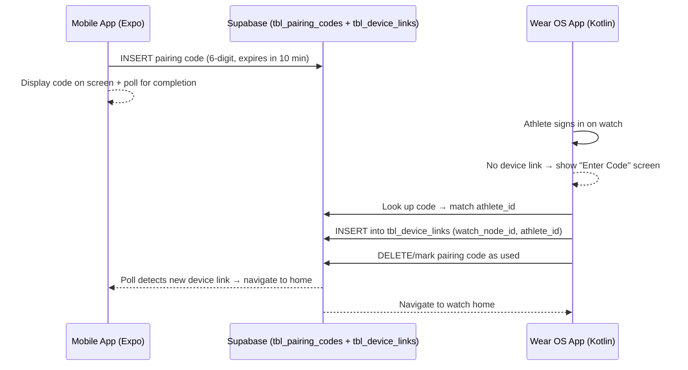

# Smartwatch Pairing Flow After Athlete Sign-In

After an athlete signs in, the app redirects to a device-check gate. If no Wear OS smartwatch is linked, the athlete is sent to a **smartwatch setup screen** where they can generate a 6-digit pairing code. The athlete enters this code on their Wear OS watch to complete the link. The same flow is mirrored on the Wear OS side.

## Pairing Architecture

## Supabase Schema Addition

A new `tbl_pairing_codes` table is needed:

| Column | Type | Notes |
|---|---|---|
| `id` | uuid (PK) | Auto-generated |
| `athlete_id` | uuid (FK → auth.users) | The athlete who generated the code |
| `code` | text (6 chars) | The 6-digit numeric code |
| `expires_at` | timestamptz | `now() + interval '10 minutes'` |
| `used` | boolean | Defaults to `false` |
| `created_at` | timestamptz | Default `now()` |

> [!IMPORTANT]
> **You need to create this table in your Supabase dashboard** before the pairing flow will work. I will provide the SQL migration as a reference file.

## Proposed Changes

### Supabase Migration (Reference)

#### [NEW] `sql/create_pairing_codes_table.sql`
Reference SQL for creating `tbl_pairing_codes`. You'll run this in your Supabase SQL editor.

---

### Pairing Code Library

#### [NEW] [`lib/pairingCode.ts`](file:///c:/Users/HP/Documents/capstone-projects/SmartAthlete/Mobile/lib/pairingCode.ts)
Utility functions for the pairing flow:
- `generatePairingCode(athleteId)` — generates a random 6-digit code, inserts into `tbl_pairing_codes`, returns the code string
- `consumePairingCode(code, watchNodeId, watchName)` — looks up a valid (unexpired, unused) code, creates a device link, marks code as used. This will be called from the Wear OS side (via Supabase client) but we define it here as a reference.
- `pollForDeviceLink(athleteId, intervalMs, onLinked)` — polls `tbl_device_links` every N seconds and calls back when a link appears

---

### Mobile App Screens

#### [NEW] [`app/athlete/smartwatch-setup.tsx`](file:///c:/Users/HP/Documents/capstone-projects/SmartAthlete/Mobile/app/athlete/smartwatch-setup.tsx)
Full onboarding-style screen with:
- Smartwatch illustration (vector icon-based, no external images)
- Explanation of pairing process
- "Generate Pairing Code" button
- Once code is generated: large, styled 6-digit code display with a 10-minute countdown timer
- Auto-polls for device link completion → navigates to `/athlete-home` on success
- "Regenerate Code" and "Skip for Now" options
- Matches the teal/green M3 theme from [`theme.ts`](file:///c:/Users/HP/Documents/capstone-projects/SmartAthlete/Mobile/constants/theme.ts)

#### [MODIFY] [`app/athlete/device-check.tsx`](file:///c:/Users/HP/Documents/capstone-projects/SmartAthlete/Mobile/app/athlete/device-check.tsx)
- Change redirect from `/smartwatch-setup` → `/athlete/smartwatch-setup` (keep route within the `athlete` folder for consistency)

#### [MODIFY] [`app/_layout.tsx`](file:///c:/Users/HP/Documents/capstone-projects/SmartAthlete/Mobile/app/_layout.tsx)
- Add `Stack.Screen` entry for `athlete/device-check` and `athlete/smartwatch-setup` (Expo Router file-based routing handles this automatically via the `athlete` directory, but we should add explicit entries so the Stack navigator knows about them and headers stay hidden)

---

### Wear OS Reference Code (Kotlin)

#### [NEW] `wearos-reference/PairingViewModel.kt`
A reference Kotlin ViewModel that:
- Signs in the athlete via Supabase (using supabase-kt)
- Checks for an existing device link
- If none, shows an "Enter Code" screen
- Validates the 6-digit code against `tbl_pairing_codes`
- Creates the device link and navigates to the watch home

#### [NEW] `wearos-reference/PairingScreen.kt`
A Compose for Wear OS screen reference with:
- Text field for the 6-digit code
- Submit button
- Error/success states

> [!NOTE]
> The Wear OS reference files are **standalone Kotlin files** placed in a `wearos-reference/` folder at the project root. They are not part of the Expo build — you'll copy the relevant logic into your Android Studio project.

## Open Questions

> [!IMPORTANT]
> **"Skip for Now" behavior**: Should "Skip" let the athlete proceed to the home screen without a watch, or should linking be mandatory? Currently planning to allow skip (navigates to home) but the device-check gate will prompt again on next sign-in.

> [!IMPORTANT]
> **Wear OS sign-in**: Does your Wear OS app already have Supabase auth set up (e.g., using `supabase-kt`)? The reference code assumes it does. If not, I can include the full Supabase setup for the Wear OS side too.

## Verification Plan

### Manual Verification
1. Sign in as athlete → confirm redirect to device-check → lands on smartwatch-setup screen
2. Tap "Generate Pairing Code" → verify 6-digit code appears with countdown
3. Verify code is inserted in `tbl_pairing_codes` in Supabase
4. Manually insert a device link row → verify the phone auto-navigates to home
5. Sign in again → verify device-check skips straight to home
6. Review Wear OS reference code compiles / is syntactically correct
